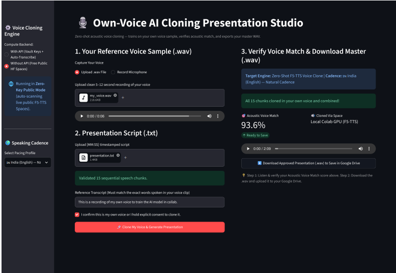
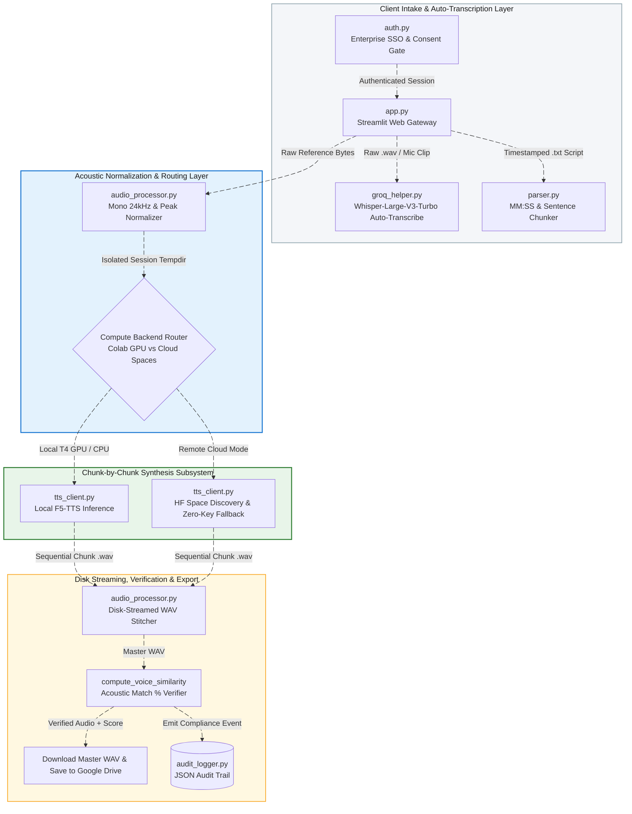
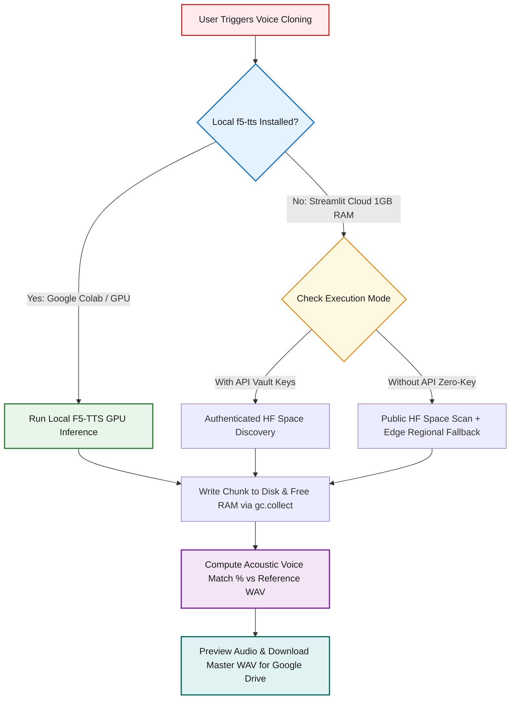

# 🎙️ Enterprise AI Voice Cloning Presentation Studio
# 🎙️ Own-Voice AI Cloning Presentation Studio
### Zero-Shot Acoustic Synthesis, Speaker Verification & Timestamp-Synchronized Narration Framework

This repository serves as a self-contained, enterprise-grade framework for automated presentation narration, zero-shot acoustic voice cloning (`F5-TTS`), and hybrid **Google Colab GPU / Streamlit Web** execution workflows.

The architecture ingests raw reference voice recordings (`.wav` or live microphone input) alongside `[MM:SS]` timestamped presentation scripts (`.txt`), auto-transcribes reference speech via **Groq Whisper**, normalizes acoustic profiles to mono 24kHz PCM, synthesizes speech **chunk-by-chunk with disk-streamed stitching** to prevent memory exhaustion, verifies speaker fidelity via an **Acoustic Voice Match (%)** meter, and exports verified master `.wav` files for **Google Drive** archiving.

### About

**Own-Voice AI Cloning Presentation Studio** built with **Streamlit**, **F5-TTS zero-shot voice cloning**, **Groq Whisper auto-transcription**, and **pure-Python acoustic similarity verification**. Features **chunk-by-chunk disk streaming (< 150 MB RAM footprint)**, **local Google Colab T4 GPU acceleration**, **automatic Hugging Face Space discovery with zero-key regional fallback**, and **automated GitHub Actions CI/CD**.

### ⭐ Show Your Support
If you explore, evaluate, or find inspiration in **Own-Voice AI Cloning Presentation Studio**, please consider giving this repository a **Star ⭐** on GitHub—it helps others discover the project and supports continued development!

---


---
---

### ⭐ Show Your Support

If you like the UI design, memory-safe chunk-by-chunk audio pipeline, or zero-shot acoustic engineering behind **Own-Voice AI Cloning Presentation Studio**, please consider giving this repository a **Star ⭐** on GitHub! It helps showcase this work and motivates future builds.

---

## Architecture Overview

### System Data Flow Architecture
The diagram below illustrates how reference recordings and timestamped scripts flow through the intake, normalization, synthesis, and verification layers before exporting your master presentation track:



---

### Hybrid Compute & Failover Logic Flow
The Synthesis Subsystem automatically adapts to available hardware—running locally on a **Google Colab T4 GPU** when `f5-tts` is installed, or routing through **Hugging Face Spaces** with regional neural fallback on lightweight cloud containers:



---


---

## 🛠️ Repository Structure

```text
voice_clone_presentation/
├── .github/
│   ├── workflows/
│   │   └── ci.yml                  # Automated GitHub Actions (ruff linting + pytest on every push)
│   └── dependabot.yml              # Automated weekly dependency security updates
├── .streamlit/
│   ├── config.toml                 # Corporate UI theme, maxUploadSize (200MB), & XSRF protection
│   └── secrets.toml.example        # Template for optional HF_TOKEN, GROQ_API_KEY, & SSO settings
├── src/
│   ├── __init__.py                 # Package initializer
│   ├── auth.py                     # Enterprise SSO/OAuth gate & safe secrets lookup
│   ├── parser.py                   # [MM:SS] timestamp parser & natural sentence chunker
│   ├── audio_processor.py          # Mono 24kHz normalizer, disk WAV stitcher & voice match scorer
│   ├── tts_client.py               # Hybrid F5-TTS engine (Local Colab GPU + HF Spaces + fallback)
│   ├── groq_helper.py              # Groq Whisper-Large-V3-Turbo auto-transcription helper
│   └── audit_logger.py             # Structured JSON compliance & observability logging
├── tests/
│   ├── __init__.py                 # Test package initializer
│   ├── test_parser.py              # Unit tests for timestamp parsing & sentence splitting
│   └── test_audio_processor.py     # Unit tests for audio normalization & silence padding math
├── app.py                          # Main Streamlit Web interface
├── packages.txt                    # System-level Linux dependency for Streamlit Cloud (ffmpeg)
└── requirements.txt                # Cloud-safe Python dependencies (< 150 MB RAM footprint)
```

---

## ⚠️ Disclaimer & Ethical AI Governance

This project is an **AI-powered zero-shot voice cloning and presentation narration platform** intended strictly for educational, research, portfolio demonstration, and authorized content production purposes. Users must only synthesize voices that they own or for which they hold explicit, verifiable consent. Any unauthorized impersonation, deceptive audio generation, or misuse of synthetic voice technology is strictly prohibited.


---

## 🛡️ License, Copyright & Compliance Notices

**All Rights Reserved © 2026 T A Srinivas.**


> **Strict Intellectual Property Notice:** This repository is strictly for portfolio viewing and technical evaluation purposes. **DO NOT COPY, CLONE, FORK, OR REDISTRIBUTE** this source code, architecture, or documentation. Stolen copies or unauthorized forks will be reported immediately for a **GitHub DMCA copyright takedown**.

For corporate licensing, enterprise deployment, or commercial inquiries, please contact **`tasrinivass@gmail.com`**.

* **Lead Architect & Developer:** [Srinivasta](https://github.com/SRINIVASTA)

### 🌐 Let’s Connect

[](https://www.linkedin.com/in/srinivas-t-a-557637119/)
[](https://www.kaggle.com/srinivasta)
[](mailto:tasrinivass@gmail.com)
[](https://github.com/srinivasta)
[](https://srinivasta.github.io)

💡 Engineered with chunk-by-chunk acoustic normalization, disk-streamed WAV stitching, and speaker similarity verification to transform raw voice recordings and timestamped scripts into studio-grade presentations.
