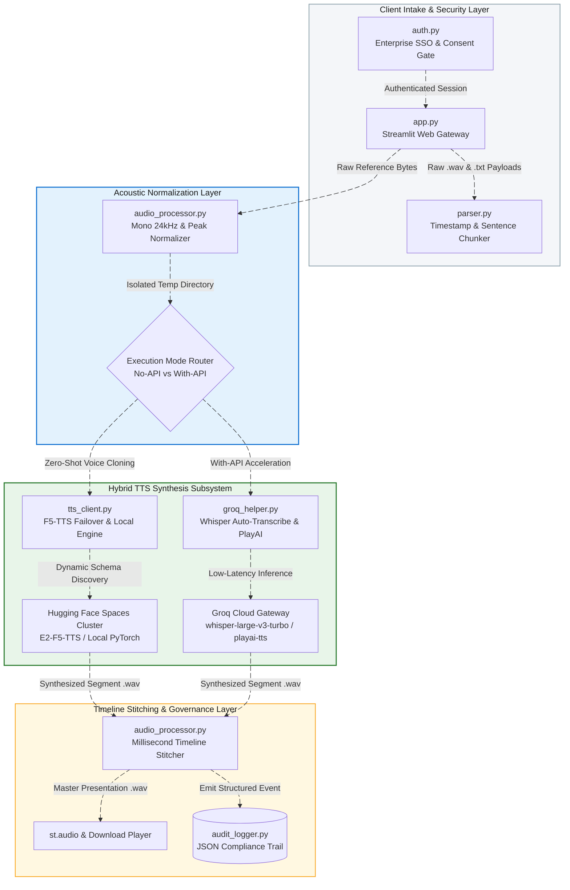
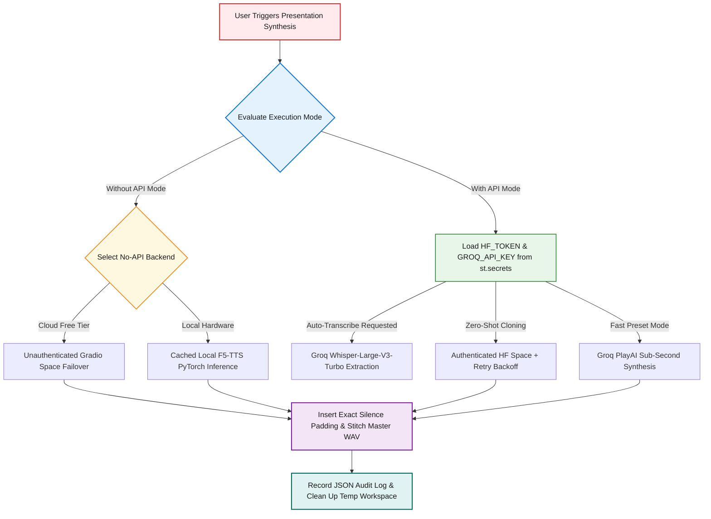

# 🎙️ Enterprise AI Voice Cloning Presentation Studio
### Zero-Shot Acoustic Synthesis & Timestamp-Synchronized Narration Framework

This repository serves as a self-contained, enterprise-grade framework for automated presentation narration, zero-shot acoustic voice cloning, and hybrid cloud/local synthesis workflows built for **GitHub Web + Streamlit Web**.

The architecture is explicitly optimized to ingest raw reference voice recordings (`.wav`) alongside `[MM:SS]` timestamped presentation scripts (`.txt`), normalize acoustic profiles to mono 24kHz tensors, and synthesize gap-aligned master narration tracks via either **No-API F5-TTS** execution or **Groq-accelerated** Whisper auto-transcription and preset voice pipelines.

### About

**Enterprise Voice Presentation Studio** built with **Streamlit**, **F5-TTS zero-shot voice cloning**, and **Groq Whisper/PlayAI hybrid acceleration**. Features **session-isolated audio normalization**, **dynamic Gradio Space endpoint failover**, **regional English accent cadence profiles (India, US, UK, AU)**, and **automated GitHub Actions CI/CD**.

---

### ⭐ Show Your Support

If you like the UI design, resilient endpoint failover architecture, or zero-shot acoustic engineering behind **Voice Clone Presentation Studio**, please consider giving this repository a **Star ⭐** on GitHub! It helps showcase this work and motivates future builds.

---

## Architecture Overview

### System Data Flow Architecture
The diagram below illustrates how user audio samples and timestamped scripts flow through the session-isolated normalization, routing, and synthesis layers before compiling into a master presentation track:



---

### Hybrid Synthesis & Failover Logic Flow
The Synthesis Subsystem routes requests deterministically based on secret availability, user execution mode, and upstream endpoint health:



---

## 🛠️ Enterprise Repository Structure

```text
voice_clone_presentation/
├── .github/
│   ├── workflows/
│   │   └── ci.yml                  # Automated GitHub Actions (ruff linting + pytest on every push)
│   └── dependabot.yml              # Automated weekly dependency security updates
├── .streamlit/
│   ├── config.toml                 # Corporate UI theme, maxUploadSize (200MB), & XSRF protection
│   └── secrets.toml.example        # Template for optional HF_TOKEN, GROQ_API_KEY, & SSO settings
├── src/
│   ├── __init__.py                 # Package initializer
│   ├── auth.py                     # Enterprise SSO/OAuth gate & speaker-consent verification
│   ├── parser.py                   # [MM:SS] timestamp parser & natural sentence chunker
│   ├── audio_processor.py          # Mono 24kHz audio normalization & millisecond timeline stitching
│   ├── tts_client.py               # Dynamic F5-TTS client (Local No-API + Remote Space failover)
│   ├── groq_helper.py              # Optional Groq Whisper auto-transcription & PlayAI preset TTS
│   └── audit_logger.py             # Structured JSON compliance & observability logging
├── tests/
│   ├── __init__.py                 # Test package initializer
│   ├── test_parser.py              # Unit tests for timestamp parsing & sentence splitting
│   └── test_audio_processor.py     # Unit tests for audio normalization & silence padding math
├── app.py                          # Main Streamlit Web interface
├── packages.txt                    # System-level Linux dependency for Streamlit Cloud (ffmpeg)
└── requirements.txt                # Pinned Python dependencies
```

---

## 📝 Document & Audio Formatting Guide

### 1. Reference Audio Sample (`.wav`)
* **Duration:** Record or upload a clean **5 to 12 second** voice clip in a quiet environment.
* **Language & Accent Profile:** Select your matching regional cadence in the sidebar (e.g., **🇮🇳 India (English) — Clear Cadence**, **🇺🇸 US**, **🇬🇧 UK**, or **🇦🇺 AU**).
* **Reference Transcript:** Ensure the text box contains the **exact word-for-word transcription** spoken inside your reference `.wav` file (or click **Auto-Transcribe** when using Groq API mode).

### 2. Presentation Script (`.txt`)
Format your presentation script using sequential `[MM:SS]` time markers. Long paragraphs are automatically split into natural sentence chunks while anchoring the start of each block to your exact timestamp:

```text
Reference Text: Hello everyone, welcome to today's quarterly product review.
[00:00] Welcome to our autonomous presentation overview. The engine verifies location metrics before launching.
[00:30] Notice that this slide profile is metered. The system will auto-terminate sessions at ten minutes.
[01:15] Our executive dashboard evaluates high-probability risk exposures and updates instantly before your eyes.
```
## ⚠️ Disclaimer & Ethical AI Governance

This project is an **AI-powered zero-shot voice cloning and presentation narration platform** intended strictly for educational, research, portfolio demonstration, and authorized content production purposes. Users must only synthesize voices that they own or for which they hold explicit, verifiable consent. Any unauthorized impersonation, deceptive audio generation, or misuse of synthetic voice technology is strictly prohibited.

Users are responsible for securing their own optional `HF_TOKEN` and `GROQ_API_KEY` credentials locally or within Streamlit Cloud Secrets (`.streamlit/secrets.toml`), adhering to Hugging Face and Groq API terms of service and rate limits, and complying with applicable biometric and voice-likeness regulations.

---

## 🛡️ License, Copyright & Compliance Notices

**All Rights Reserved © 2026 T A Srinivas.**

> **Strict Intellectual Property Notice:** This repository is strictly for portfolio viewing and technical evaluation purposes. **DO NOT COPY, CLONE, FORK, OR REDISTRIBUTE** this source code, architecture, or documentation. Stolen copies or unauthorized forks will be reported immediately for a **GitHub DMCA copyright takedown**.

For corporate licensing, enterprise deployment, or commercial inquiries, please contact **`tasrinivass@gmail.com`**.

* **Lead Architect & Developer:** [Srinivasta](https://github.com/SRINIVASTA)

### 🌐 Let’s Connect

[](https://www.linkedin.com/in/srinivas-t-a-557637119/)
[](https://www.kaggle.com/srinivasta)
[](mailto:tasrinivass@gmail.com)
[](https://github.com/srinivasta)
[](https://srinivasta.github.io)

💡 Engineered with automated acoustic normalization and millisecond timeline stitching logic to transform raw reference recordings and timestamped scripts into studio-grade presentation audio.

